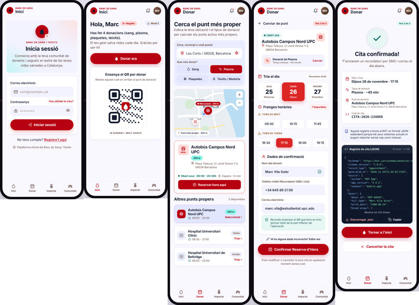

# BST App · Prototip

Prototip navegable en React de l'app del **Banc de Sang i Teixits de Catalunya**,
fet a partir del disseny de Figma d'**Adrian Ursu, Álvaro García i Sergi Romero**.




## Pantalles

| Pantalla | Què s'hi pot fer |
|---|---|
| **Inici de sessió** | Correu, contrasenya (mostrar/amagar) i accés |
| **Inici** | Grup sanguini, nivell, botó «Donar ara», QR de donant i propera cita |
| **Donar** | Ubicació, tipus de donació (sang, plasma, plaquetes, teixits/medul·la), mapa i punts propers |
| **Reserva d'hora** | Dia, franja de matí o tarda, dades de contacte editables i confirmació |
| **Confirmació** | Resum de la cita i **registre JSON** per al BST |
| **Comunitat** | Fòrum amb **valoracions d'1 a 5 estrelles**, filtres per zona i per data |
| **Impacte** | Mil·lilitres donats, desglossament i meta de punts |
| **Perfil** | Carnet digital, impacte acumulat, dades personals i exportació |
| **Historial** | Donacions completades i **exportació JSON** (total o per donació) |

## Registre de donacions en JSON

Perquè la informació de l'app es pugui importar als sistemes actuals del BST sense
feina manual, l'app genera dos tipus de registre:

- **`appointment`**: es crea en confirmar una reserva d'hora.
- **`donation_history`**: historial de donacions completades, sencer o d'una sola donació.

Es poden **descarregar** com a fitxer `.json` o **copiar** al porta-retalls.

Característiques del format:

- Claus en `snake_case` i valors codificats (`whole_blood`, `plasma`, `platelets`, `tissue_marrow`).
- Dates en ISO 8601, telèfons en E.164 i grup sanguini separat en ABO i Rh.
- Versió explícita (`schema_version`) per poder evolucionar-lo sense trencar integracions.
- Camp `isbt128_donation_id` reservat per a l'identificador ISBT 128 que assigna el BST.

L'esquema complet (JSON Schema 2020-12) és a
[`docs/bst-donation-record.schema.json`](docs/bst-donation-record.schema.json),
i la generació a [`src/lib/bstRecord.js`](src/lib/bstRecord.js).

> El format és una proposta: caldria validar els noms de camps i codis de centre
> amb l'equip tècnic del BST abans d'una integració real.

## Valoracions al fòrum

En publicar un missatge, el donant pot valorar la seva donació en tres aspectes,
d'1 a 5 estrelles:

- **Temps**: espera i durada.
- **Satisfacció**: tracte i experiència.
- **Tornaria a donar**: probabilitat de repetir.

Si el missatge és una pregunta, es pot desactivar la valoració. El fòrum mostra la
**mitjana** de les valoracions de la zona filtrada, una dada útil per al BST per
detectar punts amb massa espera o experiències millorables.

## Backoffice del BST i base de dades

L'app i el backoffice comparteixen una base de dades **Supabase** (PostgreSQL gestionat):
l'app hi escriu i el backoffice en llegeix, **en temps real**.

```
App del donant ──escriu──▶ Supabase ──llegeix──▶ Backoffice del BST ──JSON──▶ Sistemes del BST
 (cites, fòrum)           (taules)               (#/backoffice)
```

El backoffice s'obre a **`#/backoffice`** (també hi ha un enllaç al costat del mòbil) i té:

- **Resum**: cites programades, donacions del mes, satisfacció mitjana i % que tornaria a donar.
- **Cites**: les reserves que arriben de l'app; el personal les marca com a **fetes** (es crea la
  donació, que apareix a l'historial del donant) o **no presentat**.
- **Donacions**: totes les donacions i l'**exportació JSON** per als sistemes del BST.
- **Valoracions**: mitjana de temps, satisfacció i «tornaria a donar» per punt de donació, amb avís
  quan un punt té mala nota de temps.

Tot es filtra per **zona geogràfica**.

### Configuració

- Esquema, polítiques i dades de demo: [`supabase/schema.sql`](supabase/schema.sql).
- Connexió: fitxer `.env` (`VITE_SUPABASE_URL` i `VITE_SUPABASE_ANON_KEY`, la clau publicable).
- Sense `.env`, tot funciona igual en **mode local** (dades al navegador, sincronitzades entre pestanyes).
- Tota la lectura i escriptura passa per [`src/lib/db.js`](src/lib/db.js).

> **Seguretat del prototip:** com que no hi ha inici de sessió real, les polítiques RLS deixen
> llegir i escriure amb la clau pública. En producció caldria Supabase Auth perquè cada donant
> vegi només les seves dades i el backoffice sigui només per al personal del BST.

## Executar en local

Cal Node.js 18 o superior.

```bash
npm install
npm run dev
```

## Publicar a GitHub Pages

El repositori inclou un flux de GitHub Actions que publica el prototip a cada push
a `main`. Per activar-lo: **Settings → Pages → Source: GitHub Actions**.

> Totes les dades són d'exemple. Prototip acadèmic.
