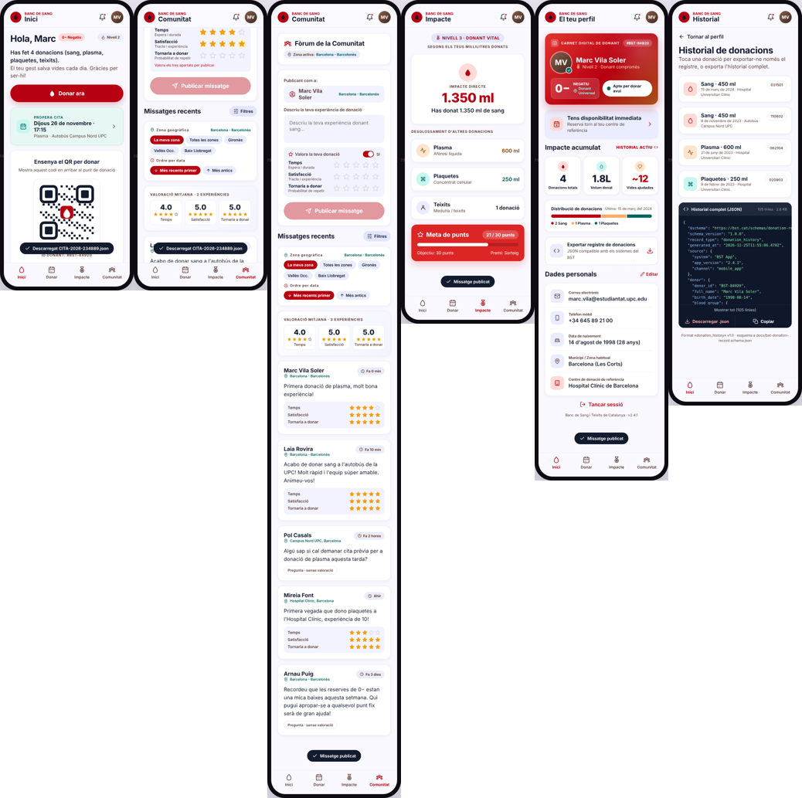

# BST App · Prototip

Prototip navegable en React de l'app del **Banc de Sang i Teixits de Catalunya**,
fet a partir del disseny de Figma d'**Adrian Ursu, Álvaro García i Sergi Romero**.




## Pantalles

| Pantalla | Què s'hi pot fer |
|---|---|
| **Inici de sessió** | Accés real amb Supabase Auth; la sessió es manté en recarregar |
| **Registre** | Alta de donant amb validació (edat 18–65, telèfon, codi postal) i consentiment RGPD |
| **Recuperar accés** | Enllaç per correu per crear una contrasenya nova |
| **Inici** | Grup sanguini, nivell, període de descans, **QR real** amb JSON i propera cita |
| **Donar** | Cerca per text o **geolocalització**, distàncies reals, horari obert/tancat i tipus de donació |
| **Reserva d'hora** | 5 dies, franges amb **places reals** (2 per franja), respecta el període de descans |
| **Confirmació** | Resum, QR de la cita, **registre JSON** i cancel·lació |
| **Comunitat** | Fòrum amb **valoracions d'1 a 5 estrelles**, filtres per zona i per data |
| **Impacte** | Mil·lilitres, punts i nivell calculats amb les donacions reals |
| **Perfil** | Carnet digital, **edició de dades**, renovar el QR, exportació i tancar sessió |
| **Historial** | Donacions completades i **exportació JSON** (total o per donació) |

## Registre de donacions en JSON

Perquè la informació de l'app es pugui importar als sistemes actuals del BST sense
feina manual, l'app genera dos tipus de registre:

- **`appointment`**: es crea en confirmar una reserva d'hora.
- **`donation_history`**: historial de donacions completades, sencer o d'una sola donació.

Es poden **descarregar** com a fitxer `.json` o **copiar** al porta-retalls.

Característiques del format:

- Claus en `snake_case` i valors codificats (`whole_blood`, `plasma`, `platelets`, `tissue_marrow`).
- Dates en ISO 8601, telèfons en E.164 i grup sanguini separat en ABO i Rh.
- Versió explícita (`schema_version`) per poder evolucionar-lo sense trencar integracions.
- Camp `isbt128_donation_id` reservat per a l'identificador ISBT 128 que assigna el BST.

L'esquema complet (JSON Schema 2020-12) és a
[`docs/bst-donation-record.schema.json`](docs/bst-donation-record.schema.json),
i la generació a [`src/lib/bstRecord.js`](src/lib/bstRecord.js).

> El format és una proposta: caldria validar els noms de camps i codis de centre
> amb l'equip tècnic del BST abans d'una integració real.

## Valoracions al fòrum

En publicar un missatge, el donant pot valorar la seva donació en tres aspectes,
d'1 a 5 estrelles:

- **Temps**: espera i durada.
- **Satisfacció**: tracte i experiència.
- **Tornaria a donar**: probabilitat de repetir.

Si el missatge és una pregunta, es pot desactivar la valoració. El fòrum mostra la
**mitjana** de les valoracions de la zona filtrada, una dada útil per al BST per
detectar punts amb massa espera o experiències millorables.

## QR del donant

El QR de la pantalla d'Inici és un codi real (llegible per qualsevol escàner) que conté un JSON:

```json
{
  "type": "bst.checkin",
  "v": 1,
  "donor_id": "BST-10001",
  "token": "uuid secret del donant",
  "appointment_id": "CITA-2026-123456",
  "appointment_token": "uuid secret de la cita"
}
```

- Els **tokens** són aleatoris i es guarden a la base de dades: un QR inventat o copiat d'un altre
  donant no es pot validar. El donant pot **renovar el QR** des del perfil (invalida l'anterior).
- Si el donant té una cita, el QR la porta; si no, només identifica el donant.
- El personal el llegeix al backoffice (**Escàner QR**) amb la càmera, pujant una foto o enganxant el JSON.
  La funció `verify_qr` comprova els tokens i mostra el donant i la cita; des d'allà es registra
  l'**arribada** i la **donació feta** (que apareix a l'historial del donant en temps real).

## Backoffice del BST i base de dades

L'app i el backoffice comparteixen una base de dades **Supabase** (PostgreSQL gestionat), **en temps real**.

```
App del donant ──reserva / QR──▶ Supabase ◀──escàner / gestió── Backoffice del BST ──JSON──▶ Sistemes del BST
```

El backoffice s'obre afegint **`#/backoffice`** a la URL de l'app i **només hi pot entrar el personal**
(taula `staff`). Té:

- **Resum**: cites programades, donacions del mes, satisfacció mitjana i % que tornaria a donar.
- **Escàner QR**: valida el QR del donant i registra arribada, donació feta o no presentat.
- **Cites**: les reserves que arriben de l'app i el seu estat.
- **Donacions**: totes les donacions i l'**exportació JSON** per als sistemes del BST.
- **Valoracions**: mitjana de temps, satisfacció i «tornaria a donar» per punt de donació.

L'app i el backoffice tenen **sessions separades**: es poden tenir oberts alhora al mateix navegador.

### Seguretat

- **Supabase Auth** per a donants i personal.
- **RLS**: cada donant només veu les seves cites i donacions; el personal ho veu tot.
- Les cites i donacions només es creen amb funcions de la base de dades (`book_appointment`,
  `complete_appointment`…), que validen places, període de descans i permisos.
- L'autor dels missatges del fòrum el posa la base de dades a partir de la sessió.

### Configuració (una sola vegada)

1. Supabase → **SQL Editor**: executa [`supabase/schema.sql`](supabase/schema.sql) (si la base de dades és nova)
   i després [`supabase/migrations/002_auth_qr.sql`](supabase/migrations/002_auth_qr.sql).
2. Supabase → **Authentication → URL Configuration**: posa l'adreça de GitHub Pages com a *Site URL*
   i afegeix-la (i `http://localhost:5173`) a *Redirect URLs*, perquè funcionin els enllaços dels correus.
3. Supabase → **Authentication → Sign In / Providers → Email**: per a la demo, desactiva
   *Confirm email* (el servei de correu gratuït de Supabase només envia a membres del projecte).
   Si el deixes actiu, cal configurar un SMTP propi.
4. Registra a l'app un compte de donant i un de personal, i executa
   [`supabase/demo_accounts.sql`](supabase/demo_accounts.sql) amb els dos correus.
5. Connexió: fitxer `.env` (`VITE_SUPABASE_URL` i `VITE_SUPABASE_ANON_KEY`, la clau publicable).

## Executar en local

Cal Node.js 18 o superior.

```bash
npm install
npm run dev
```

## Publicar a GitHub Pages

El repositori inclou un flux de GitHub Actions que publica el prototip a cada push
a `main`. Per activar-lo: **Settings → Pages → Source: GitHub Actions**.

> Totes les dades són d'exemple. Prototip acadèmic.
